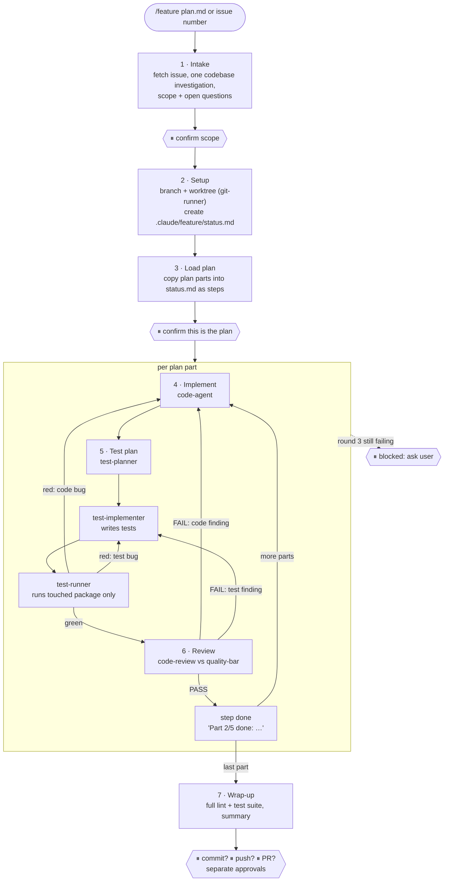

# Claude_code_settings
Contains plugins, settings used by me for Claude code

## Skills
Located in `claude/skills/`. Each skill is a `SKILL.md` that Claude loads when its description matches the task, or when you call it by name (`/<skill>`).

| Skill | Trigger | What it does |
|---|---|---|
| **feature** | manual only: `/feature <plan.md \| issue #>` | Orchestrates a whole feature from an existing plan by driving subagents (see below). |
| **model-selector** | before delegating any work | Picks the subagent type first (`git-runner`, `os-agent`, `test-runner`, `code-agent`, `code-review`, …), then the model tier (Haiku → Sonnet → Opus → Fable). Production code is always written and reviewed on Opus. Hints `/model` when the main-thread model is a poor fit. |
| **quality-bar** | implementing or reviewing code | Shared quality standard (security, correctness, error handling, concurrency, performance, architecture, tests, docs) with Critical/High/Medium/Low severities. `code-agent` builds to it, `code-review` judges against it. Critical and High must be zero before hand-off. |
| **commit-clean** | writing a commit message | Git commit messages with no AI attribution (no `Co-Authored-By: Claude`, no "Generated with" lines), Conventional Commits format. |
| **create-worktree** | "create a worktree", isolated work | Creates git worktrees under `worktrees/` inside the project root, never as sibling directories. |
| **csharp-style** | writing or editing C# | Explicit types (no `var`), XML doc comments on public/internal members, braces on all `if`/loops, explicit created types (no `new()`). |

### feature — the feature orchestrator

`/feature` takes a plan someone already wrote (a Markdown file or a GitHub issue) and executes it part by part. The main thread acts only as **orchestrator**: it routes work, tracks state and talks to you. It never plans, writes production code, or runs git/shell/test commands itself; every task goes to a dedicated subagent.

```
/feature docs/plans/login-rework.md
/feature 142
```

#### Ground rules
- **Never plan.** The plan is input. If it is missing, unclear or wrong, the orchestrator stops and asks.
- **Delegate, do not do.** Each role has one agent; tasks outside the roster go through `model-selector`.
- **Repo rules win.** The repo's `CLAUDE.md` (worktree naming, lint, tests) overrides the skill and is passed to every agent.
- **One agent per role, resumed.** Each agent is spawned once, its id is saved in `status.md`, and later steps resume it with `SendMessage`, so it keeps its context.
- **State lives in files.** Everything is on disk, so a session reset resumes where it stopped.
- **User gates (⏸).** It stops for your confirmation at fixed points and never commits, pushes or opens a PR without a separate approval for each.
- **Stop on repeated failure.** 3 failed fix rounds on one part: the step goes `blocked` and you decide.

#### Agent roster

| Work | Agent | Model |
|---|---|---|
| Git / worktree | `git-runner` | Haiku |
| Shell | `os-agent` | Haiku |
| Implementation | `code-agent` | Opus |
| Review | `code-review` | Opus |
| Test planning | `test-planner` | Opus |
| Test writing | `test-implementer` | Haiku |
| Test running | `test-runner` | Haiku |

#### Phases



Same loop, as the orchestrator sees it: every agent reports back to the orchestrator, which routes the fix or moves on.

```
                ┌──────────────────────── orchestrator (main thread) ────────────────────────┐
                │   reads status.md · routes work · forwards findings verbatim · gates ⏸     │
                └──┬───────────┬──────────────┬──────────────┬──────────────┬────────────────┘
                   │ part      │ part+files   │ test list    │ run          │ part+files
                   ▼           ▼              ▼              ▼              ▼
             ┌───────────┐ ┌────────────┐ ┌──────────────┐ ┌───────────┐ ┌─────────────┐
             │code-agent │ │test-planner│ │test-implement│ │test-runner│ │ code-review │
             │  (Opus)   │ │  (Opus)    │ │   (Haiku)    │ │  (Haiku)  │ │   (Opus)    │
             └─────┬─────┘ └─────┬──────┘ └──────┬───────┘ └─────┬─────┘ └──────┬──────┘
                   │ files,      │ test names    │ test files    │ pass/fail     │ PASS/FAIL +
                   │ risks       │ + intent      │               │ + errors      │ R<n> findings
                   └─────────────┴───────────────┴───────────────┴───────────────┘
                                               ▼
                                   back to orchestrator → next step
```

#### Fix rounds
- **Test failure triage:** test matches the plan but code disagrees → `code-agent`; test broken or asserts something the plan does not say → `test-implementer`; unclear → `code-agent` decides which side is wrong.
- **Review findings** come as `R<n> <Critical|High|Medium|Low> <file:line> <problem> → <fix>`. Critical and High must be fixed; Medium is fixed or its skip is justified in `status.md`; Low is only logged.
- Findings are forwarded **verbatim with their ids**. The fixer answers per id: `fixed` or `disputed` (disputes the orchestrator can't settle go to you).
- After a fix: tests rerun, then the **same** reviewer re-checks only its ids and the new diff.
- Rounds are counted per part (`round 2/3`); round 3 still failing → `blocked`, ask the user.

#### State on disk

```
<worktree>/.claude/feature/
├── status.md            # orchestrator's board: every step, its status, who is on it
├── plan.md              # only when the plan came from an issue
└── agents/
    ├── code-agent.md    # one file per agent, written only by that agent
    ├── test-planner.md
    └── ...
```

- `status.md` — written only by the orchestrator: input, branch/worktree, plan path, current phase, a **Steps** table (`not ready | ongoing | blocked | done`, agent, "doing now"), an **Agents** table (agentId, status file, current step) and decisions/open questions.
- `agents/<agent>.md` — each agent's own log (`working | done | failed | waiting`, doing now, timestamped log). Agents without a write tool (`code-review`) get theirs written by the orchestrator.
- On restart the orchestrator reads `status.md`, then the agent files of the ongoing step, and resumes.

#### Live pane: `featuremode` mod
`claude/mods/featuremode/` adds a terminal pane that polls `.claude/feature/status.md` every 2 s and shows the feature name, phase, progress, each step with its status (`✓` done, `•` ongoing, `✗` blocked, `○` not ready) and the agent on it, plus the top skills used (counts from the `tollasmode` mod). The pane opens on its own the first time a board appears; `/featuremode` shows/hides it.

```
┌ Feature ───────────────────────────┐
│ login-rework                       │
│ Phase 5 · 1/4 done · updated 14:02 │
│ ✓ 1. Token model                   │
│ • 2. Refresh flow      code-agent  │
│ ✗ 3. Session store                 │
│ ○ 4. Logout endpoint               │
│                                    │
│ Top skills                         │
│ feature        ████████████   12   │
│ quality-bar    ██████          6   │
└────────────────────────────────────┘
```

## Plugins
See [plugins.md](plugins.md) for install commands and details.

- **[caveman](https://github.com/juliusbrussee/caveman)** — ultra-compressed communication mode plus `cavecrew-*` subagents (investigator/builder/reviewer) for token-efficient delegation.
- **[code security review](https://github.com/anthropics/claude-code-security-review)** — `comprehensive-review@claude-code-workflows` (architect-review, code-reviewer, security-auditor agents).
- **code-simplifier** — Anthropic official plugin; cleans up recently modified code for clarity without changing behavior.
- **[dev-pipeline](plugins.md#dev-pipeline)** (this repo, `dev-pipeline-plugin/`) — plan → implement → review → test loop with dedicated subagents. Install:
  ```
  /plugin marketplace add mxrpr/Claude_code_settings
  /plugin install dev-pipeline@dev-pipeline-marketplace
  ```

## Hooks
- `claude/prehooks/settings.json` — `PreToolUse` hook on `Bash`: blocks direct Bash calls from the main thread, forcing delegation to `os-agent` (general shell), `git-runner` (git ops), or `test-runner` (test commands); also blocks `os-agent` from running git/test commands directly.

## Agents
Located in `claude/agents/` (all run on Haiku unless noted):

- **git-runner** — executes git commands; read-only ops run freely, destructive/shared-state ops (push, reset --hard, etc.) need explicit authorization.
- **os-agent** — executes shell/OS ops; read-only ops run freely, destructive ops need explicit authorization; never starts long-running servers.
- **test-planner** (Sonnet) — plans test coverage without writing code.
- **test-implementer** — writes and runs tests from a plan.
- **test-runner** — runs existing test suites and reports pass/fail only, never fixes.

## Commands

### Usage
```
/dev-pipeline <plan or feature description>
```
Run it with a plan or feature description as argument. It plans first and stops for your review — nothing gets implemented until you tell it to continue. After that it works through the plan.md checklist one part at a time (implement → review → test), pausing between parts for you to say go-ahead.

/dev-pipeline: starts the plan → implement → review → test loop. Planning subagent breaks the request into ordered parts in `plan.md` and stops for your review. Then, per part: implementation → code-review (up to 2 retries on flagged issues) → test-planner/test-writer/test-executor, pausing after each part for the go-ahead. `plan.md`'s checklist is the source of truth for where it stopped across session resets. See [plugins.md](plugins.md) for the full flow.

